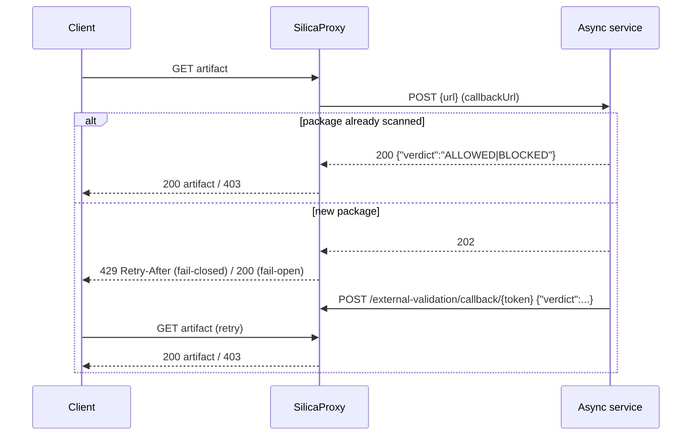

# Data Sources

SilicaProxy evaluates security decisions in order of priority, pulling from multiple data sources:

## What "fail-open" / "fail-closed" means

Several of the checks below depend on a remote call that can fail (a registry being
unreachable, an external validation service timing out, the OSV/deps.dev live APIs returning
an error). Each of these checks has a configurable policy for that failure case:

- **`fail-open: true`** (the default almost everywhere) — if the check can't get an answer,
  **allow** the package rather than block a build over an infrastructure hiccup.
- **`fail-open: false`** (i.e. fail-closed) — if the check can't get an answer, **block** the
  package instead, favoring security over availability.

This choice is configured independently for quarantine (`silicaproxy.quarantine.fail-open`,
[§3](#3-public-registry-metadata--on-demand-cached-permanently)), each external validation
service (`...services.<name>.fail-open`, [§4](#4-external-validation-services--on-demand-sync-or-async)),
and each live API fallback source (`silicaproxy.api-fallback.<osv|deps-dev>.fail-open`,
[§5](#5-live-security-api-fallback--on-demand-configurable-cache-priority-3)) — a hardened
environment can flip any of them to fail-closed without affecting the others.

For quarantine, `silicaproxy.quarantine.fail-open` (default `true`) decides the verdict whenever
the **publication date cannot be resolved** at all : registry unreachable, package/version
unknown to the registry (and to the origin registry for npm), and no date already cached in
`package_metadata`. Such packages skip the age check entirely, so every occurrence is counted in
`silicaproxy.quarantine.publish_date.unresolved` (tagged with the final verdict) — see
[Metrics](operations.md#metrics) for a ready-to-use alert.

Fail-open only skips the checks that need the publication date (age, deprecation) : the
[external validation services](#4-external-validation-services--on-demand-sync-or-async) still
run, each under its own `fail-open` policy, and a BLOCK from any of them wins. A service
configured `fail-open: false` that cannot vet the package during a public registry outage (for
instance because it downloads it from that registry) therefore blocks it. A service that cannot
fetch a package should answer with an error, never `BLOCKED` : a `BLOCKED` verdict is permanent.

Two options narrow that gap without turning the whole quarantine fail-closed :

- **`silicaproxy.quarantine.unknown-version-action`** — a version that every registry consulted
  answered it does **not know** (HTTP 404, version absent from the release list) is not an outage.
  `FOLLOW_FAIL_OPEN` (default) treats it like one, so `fail-open` decides ; `BLOCK` always blocks
  it with `step: REGISTRY_NOT_FOUND`. A registry that could not answer (5xx, timeout, network
  error, unparseable response) still follows `fail-open`.
- **`silicaproxy.quarantine.check-vulnerabilities-on-registry-error`** — with `true` (default), a
  package let through by `fail-open` still goes through the
  [OSV/deps.dev chain](#5-live-security-api-fallback--on-demand-configurable-cache-priority-3) :
  a BLOCK wins, otherwise the verdict stays `REGISTRY_ERROR` ALLOW. `false` skips the live
  vulnerability APIs for such packages.

Neither verdict is cached : the next request re-evaluates the package. The `REGISTRY_ERROR` ALLOW
in particular is **never cached**, even when every external validation service allowed the
package : caching it would skip the quarantine check for the whole TTL once the registry recovers.

### Upstream rate limiting (HTTP 429)

A rate limit is not handled like an outage : whoever can send enough requests through the proxy
can provoke one, and following `fail-open` would then let a freshly published version skip the
quarantine — for good, since the artifacts repository in front keeps it in its cache.

- **The host is left alone.** After a 429 from a registry, OSV or deps.dev, no call is sent to that
  host until its `Retry-After` (seconds or HTTP date), or a backoff doubled on each new 429 when it
  sent none — always within `[min-backoff-seconds, max-backoff-seconds]` (5 s – 15 min by
  default). Meanwhile, relayed requests to it get a `429` with the remaining `Retry-After`, and
  Maven's second publish-date lookup (on the requested URL) is skipped when it targets the same
  host. Per instance, in memory ; the first 2xx after a suspension resets the backoff.
- **The decision fails closed** with `upstream-throttle.on-throttle: FAIL_CLOSED` (default) : a
  publish date that only a rate-limited registry could give (no cached date), an OSV/deps.dev check
  that only failed on 429, or a deps.dev digest lookup that did, block with `step: UPSTREAM_THROTTLED`
  — answered **`429` with `Retry-After` and `Cache-Control: no-store`** rather than 403, so the
  artifacts repository retries later instead of remembering the artifact as forbidden. This verdict
  is never cached. A cached publish date still lets the quarantine decide normally.
  `FOLLOW_FAIL_OPEN` restores the previous behaviour (each source's `fail-open` decides). Only 429
  counts : a 5xx, a timeout or a network error still follows `fail-open`.

## 1. Company policies — GitOps sync every 10 minutes (Priority 1)

Internal allow/block rules are read from a Git repository containing one YAML file per ecosystem (`npm.yaml`, `pypi.yaml`, `maven.yaml`). The scheduler pulls changes every 10 minutes and synchronises the `company_policies` table. These rules have the **highest priority** in the decision pipeline and always override external vulnerability data.

---

## 2. Public vulnerabilities — nightly batch sync + hourly incremental (Priority 2)

These are downloaded once a day and stored locally in PostgreSQL, so every proxy decision is resolved from a local SQL query with no external dependency at request time.

| Source | What it covers | Format |
|---|---|---|
| **Google OSV** | CVEs for npm, PyPI, Maven | ZIP archives downloaded per ecosystem |
| **GitHub Advisory Database (GHSA)** | Curated security advisories across all ecosystems | Git clone (`github/advisory-database`) |
| **GitLab Advisory Database** | Additional advisories, especially for Ruby/Go/Java | Git clone |
| **OpenSSF Malicious Packages** | Known malware, typosquatting campaigns, sabotage incidents | Git clone |

All six sources (3 OSV ZIPs + 3 Git repositories) are synchronized **in parallel** on virtual threads. A failure in one source (e.g. a Git repository temporarily unreachable) does not block or delay the others. Progress is tracked per-job and visible at `/api/vulnerabilities/sync/status`.

Within a single OSV ZIP, one malformed advisory (unexpected JSON shape) does not abort the whole ~500k-entry run either: it's logged, counted in `sync_run_history.items_failed`, and skipped — the rest of the archive is still ingested, matching the per-advisory resilience of the hourly incremental sync below.

SemVer version ranges from the advisories are flattened into a concrete list of affected versions at ingestion time, enabling a fast JSONB containment check (`@>`) at query time.

### 2.1 Incremental OSV updates — hourly sync (between nightly batches)

Between nightly batch syncs, SilicaProxy fetches the `modified_id.csv` index files published by Google on the same GCS bucket. These files list every advisory modified in the last N hours, sorted newest-first. The service reads them from the top and stops as soon as it reaches an entry older than its watermark, so only the delta is downloaded. The watermark is the start of the last successful run (in `sync_run_history`) less `overlap-minutes` (default: 15): OSV may list an advisory in the CSV after a run read it, with an earlier modified time, and replaying the overlap is harmless. A failed run does not move it.

| Ecosystem | GCS index file |
|---|---|
| npm | `https://storage.googleapis.com/osv-vulnerabilities/npm/modified_id.csv` |
| PyPI | `https://storage.googleapis.com/osv-vulnerabilities/PyPI/modified_id.csv` |
| Maven | `https://storage.googleapis.com/osv-vulnerabilities/Maven/modified_id.csv` |

For each advisory ID in the delta, the service fetches the corresponding JSON file and upserts it into `public_vulnerabilities`. An advisory OSV no longer serves (HTTP 404) is skipped, not counted as a failure. A failure on a single advisory (any other HTTP error, an empty body, an unparsable JSON) is logged and recorded in `osv_incremental_failed_advisories` — the others are still processed. Each run retries the recorded advisories first, until they succeed, a nightly zip of the ecosystem started after their last failure succeeds, or they have been retried `max-retry-attempts` times (default: 24, logged as a warning and counted with outcome `ABANDONED`). Three new `sync_status` job IDs track these runs: `osv-npm-incremental`, `osv-pypi-incremental`, `osv-maven-incremental`.

The incremental sync runs **every hour** under ShedLock (`osv-incremental-sync`). On first run (no watermark), it fetches the last `initial-lookback-hours` of changes (default: 25 h) to bridge the gap until the next nightly batch.

## 3. Public registry metadata — on-demand, cached permanently

When a package version is not in any local database, SilicaProxy queries the registry to retrieve:
- **Publication date** — used for the quarantine check (anti-typosquatting)
- **Deprecation / yanked status** — used for the deprecation check (npm and PyPI only)

| Ecosystem | Default registry | Publication date | Deprecation / yanked | YAML / Env var |
|---|---|---|---|---|
| **npm** | `registry.npmjs.org` | ✓ | ✓ (`deprecated` field) | `silicaproxy.registries.npm-url` / `SILICAPROXY_REGISTRIES_NPM_URL` |
| **PyPI** | `pypi.org` | ✓ | ✓ (`yanked` field) | `silicaproxy.registries.pypi-url` / `SILICAPROXY_REGISTRIES_PYPI_URL` |
| **Maven** | `repo1.maven.org` | ✓ (`Last-Modified` header) | — not supported | `silicaproxy.registries.maven-url` / `SILICAPROXY_REGISTRIES_MAVEN_URL` |

How the publication date is resolved :

- **PyPI** — a release can receive new files (e.g. wheels for a new Python version) long after it
  was first published, so the date used is the upload time of the **file actually downloaded**
  (matched by filename against the release's files). If it can't be matched, the **most recent**
  upload of the release is used — never the first file's, which would let a freshly added file
  inherit the release's old age.
- **npm** — the configured public registry is **always asked first**. The packument relayed to the
  client, and the registry it came from (npm.jsr.io, a private Verdaccio/Artifactory…), are only
  used when the public registry answers that it does **not know** the package/version (404, or no
  `time` entry for it) — never when it merely fails to answer (5xx, timeout), so a registry outage
  can't hand the quarantine date over to a less trusted source.
- **Maven** — the `Last-Modified` header of the version directory on Maven Central
  (`HEAD /maven2/{group}/{artifact}/{version}/`). If Central does not answer with a date (404,
  artifact not mirrored there, or outage), the URL the client actually requested is `HEAD`ed
  instead and its `Last-Modified` is used.
- **All ecosystems** — every lookup tells a registry that does **not know** the package/version
  (`NOT_FOUND` : HTTP 404, version absent) apart from one that **could not answer**
  (`UNAVAILABLE` : 5xx, timeout, network error, unexpected response). Either way, a date already
  cached in `package_metadata` is used first (for PyPI only while it is still quarantined, see
  below) ; otherwise the
  [`quarantine.fail-open`](#what-fail-open--fail-closed-means) policy decides, except that a
  `NOT_FOUND` is blocked outright when `quarantine.unknown-version-action` is `BLOCK`.

The publication date is **stored permanently** in the `package_metadata` table, one row per version. A deprecation verdict is also cached permanently. Only the quarantine verdict is never cached, so it is naturally re-evaluated at each request until the package ages out.

The registry is still queried for a version already seen, because the deprecated / yanked status is never stored and must stay fresh — except when that status can't change the verdict : the cached date says the version is still quarantined (blocked either way), or deprecation filtering is off for the ecosystem (Maven). PyPI dates each **file** of a release, and the cached date is that of whichever file was resolved first : a still-quarantined one means the release holds a fresh file, so the request is blocked without a lookup (an older file of that release may then be blocked until the fresh one ages out) ; any other cached date proves nothing for the requested file, which is looked up. For the same reason, no `ALLOW` is written to `api_cache` while any file of a PyPI release is still quarantined.

### Package identification

Registry metadata, like every other check, is only looked up once the request's ecosystem, package
name and version are identified — otherwise the request is relayed **without any security check**.
How each ecosystem is identified (npm tarballs, Maven artifacts, PyPI files, client header hints,
identification from the upstream response digest) and the known limits are described in
[PACKAGE_IDENTIFICATION.md](PACKAGE_IDENTIFICATION.md).

## 4. External Validation Services — on-demand, sync or async

SilicaProxy can call any number of external HTTP services to validate a package before reaching the live API fallback. This is designed for deep scanners that are too slow to block a build synchronously, or for proprietary tools with custom scoring.

### Sync mode

The proxy makes a POST call to the service and waits up to `timeout-seconds` (1 second by default) for a response. If the service replies in time, the verdict is applied immediately. On timeout, network error or unexpected verdict, the configurable `fail-open` / `fail-closed` policy applies (see [Missing verdict](#missing-verdict-fail-closed--429)).

```
POST {url}
Body: { "packageName": "lodash", "version": "4.17.21", "ecosystem": "npm",
        "url": "https://registry.npmjs.org/lodash/-/lodash-4.17.21.tgz" }

Response: { "verdict": "BLOCKED", "reason": "Malicious dependency detected." }
```

### Async mode

The proxy POSTs a trigger and waits only for the acknowledgment (`http-client.external-validation-read-timeout-seconds`, 1 s by default). The service scans in the background and calls back the proxy with the verdict. A service that **already knows** the package may put the verdict in the acknowledgment itself : it is applied to the current request, with no 429 and no wait for the callback.

```
POST {url}
Body: { "packageName": "lodash", "version": "4.17.21", "ecosystem": "npm",
        "url": "https://registry.npmjs.org/lodash/-/lodash-4.17.21.tgz",
        "callbackUrl": "https://proxy.yourcompany.com/external-validation/callback/{token}" }

Acknowledgment (2xx), either:
  { "verdict": "ALLOWED", "reason": "Clean." }    # known package : applied now
  anything else (empty, 202, {"status":"PENDING"}) # verdict to come by callback

→ Callback (later): POST /external-validation/callback/{token}
  Header: Authorization: Bearer {api-key}   # only required if api-key is configured for this service
  Body: { "verdict": "ALLOWED", "reason": "Clean." }
```



The callback token is a UUID generated per request. The endpoint returns `404` if the token is unknown or has already been resolved — e.g. a callback still sent after a verdict given in the acknowledgment.

### Missing verdict (fail-closed → 429)

A real `BLOCKED` verdict from a `blocking: true` service is permanent : the proxy answers **403**
(step `EXTERNAL_VALIDATION`). When a `blocking: true`, `fail-open: false` service has **no verdict
yet**, the block is only temporary : the proxy answers **429** with `Retry-After`
(`silicaproxy.external-validation.retry-after-seconds`, 30 by default) and `Cache-Control: no-store`,
with one of two steps :

| Step (`error`) | Cause |
|---|---|
| `EXTERNAL_VALIDATION_PENDING` (`ExternalValidationPending`) | A scan is running : async callback not arrived yet (within `pending-ttl-minutes`), or a concurrent sync call for the same package still in progress. |
| `EXTERNAL_VALIDATION_UNAVAILABLE` (`ExternalValidationUnavailable`) | The service could not give a verdict : sync timeout, network error, unexpected verdict, an async trigger it did not acknowledge, or no callback within `pending-ttl-minutes` (the request triggers a new scan). |

A real `BLOCKED` verdict wins over a missing one, and `UNAVAILABLE` is reported before `PENDING`.
The `detail` names the services concerned. A `blocking: false` service never blocks, whatever its
`fail-open`.

Why 429 and not 403 : behind Artifactory or Nexus, a 403 from the upstream may be kept in the
repository's negative cache, so the artifact would stay unavailable long after the scan allowed it.
Why not 503 : a 5xx can make the repository manager take the **whole** remote repository offline.

With an async service in fail-closed, the **first** download of a version the service has not
scanned yet is therefore refused (Gradle or npm fail on it) : retry once the scan has called back.

If `api-key` is configured for the service (see [Configuration Reference](configuration.md#full-variable-table)), the callback must present it back as `Authorization: Bearer {api-key}`, or the endpoint returns `401`. This is optional: a service with no `api-key` configured accepts callbacks with no `Authorization` header at all, exactly as before. The unguessable per-request UUID token is itself some protection, but it's not authentication — anyone who learns a pending token (logs, a leaked URL, a network observer) can otherwise forge a verdict for that request without it.

### Persistence

| Verdict | Destination | Expiry |
|---|---|---|
| BLOCKED (blocking=true) | `external_validation_verdicts` | **Permanent** — no TTL, manual removal only |
| ALLOWED | `external_validation_cache` | Configurable TTL (`cache-ttl-minutes`) |
| PENDING (async, waiting) | `external_validation_cache` | Configurable TTL (`pending-ttl-minutes`), then → TIMEOUT |
| BLOCKED (blocking=false) | `external_validation_verdicts` | **Permanent** — stored for observability, but never enforced as long as `blocking=false` |

A BLOCKED verdict written to `external_validation_verdicts` is **permanent**: it is never cleaned up automatically and is applied on every subsequent request for that package, regardless of any other check.

When every enabled service definitively ALLOWED the package and the [fallback chain](#5-live-security-api-fallback--on-demand-configurable-cache-priority-3) then allows it too, that final ALLOW is cached in `api_cache` (source `EXTERNAL_VALIDATION_CHAIN`), so the next downloads skip the registry, external and OSV calls. Its TTL is the smallest of `api-cache.allow-verdict-ttl-minutes` and the remaining validity of each service's ALLOW (at most its `cache-ttl-minutes`). Nothing is cached while a scan is pending or after a fail-open error/timeout, and an async BLOCKED callback deletes the cached ALLOW so the very next request is blocked.

### Multi-service execution order

When multiple services are configured:

0. **Short-circuit**: if *any* service with `blocking: true` already has a permanent verdict for this exact package/version (from a previous sync call or async callback), the proxy returns `BLOCK` immediately and skips every network call — to its own service and to every other configured service. This is what makes the permanent block in step 4 actually permanent in practice: once one blocking scanner has spoken, the others are never asked again for that package/version.
1. Otherwise, all **SYNC** services run in parallel — the proxy waits for every sync response.
2. If any sync service produces an effective BLOCK → the package is blocked. ASYNC services are **not triggered**, unless `trigger-async-on-sync-block: true` (in which case they run fire-and-forget, for the audit trail only).
3. If all sync services ALLOW → all **ASYNC** services are triggered in parallel ; the proxy waits for their acknowledgments, to use a verdict given there.
4. Final verdict: **the most restrictive wins** — one BLOCK from any service is enough.

### `blocking` flag

Each service can be configured with `blocking: false` to make it **informational only**: the verdict is still stored in the DB and appears in audit logs, but never blocks a package. Useful for trialling a new scanner in shadow mode before enforcing it.

### Upstream HEAD check (`head-check`)

Behind a virtual repository (for example a Nexus group that asks Maven Central first, then the Gradle Plugin Portal), the client's request can reach the proxy for an artifact that only one of the upstreams holds. If the scanner is called with that URL, it fetches a file that does not exist there and the package stays PENDING.

With `head-check: true`, the proxy sends a `HEAD` to the requested URL before calling the service:

- **200 / 3xx**: the artifact exists here, the service is called as usual.
- **404**: the service is skipped for this request — no call, no verdict, no PENDING row. If every service is skipped, the decision goes on with the [fallback chain](#5-live-security-api-fallback--on-demand-configurable-cache-priority-3), and the request is relayed to the upstream, which answers its own 404 so the repository manager moves on to the next member.
- **Error, timeout or 429**: the service is called as if no check ran. The HEAD is an optimisation and never a reason to skip a scan on its own.

The URL is upgraded to HTTPS by the same policy as the relay (`HttpsUpgradePolicy`), and the outcome is cached in `upstream_head_cache` for `head-check-cache-ttl-minutes`. Only `found` and `not found` are cached; errors are not, so the next request retries. The HEAD goes through the same SSRF protection and upstream rate-limit suspension as the other outbound calls.

The default is `false`, so existing deployments are unchanged.

### Configuration example

```yaml
silicaproxy:
  external-validation:
    callback-base-url: "https://proxy.yourcompany.com"   # required for async mode
    trigger-async-on-sync-block: false                   # trigger async even when sync blocks
    services:
      snyk:
        enabled: true
        url: "https://scanner.yourcompany.com/v1/check"
        api-key: "${EXTERNAL_SCANNER_API_KEY}"
        mode: sync
        timeout-seconds: 1
        fail-open: true
        blocking: true
        cache-ttl-minutes: 1440
        head-check: true                 # skip this service when the upstream answers 404 for the artifact
        head-check-timeout-seconds: 5
        head-check-cache-ttl-minutes: 10

      deep-scanner:
        enabled: true
        url: "https://deep-scanner.yourcompany.com/analyze"
        api-key: "${DEEP_SCANNER_API_KEY}"
        mode: async
        fail-open: true
        blocking: true
        cache-ttl-minutes: 10080
        pending-ttl-minutes: 60

      package-name-guardian:
        enabled: true
        url: "https://package-name-guardian.yourcompany.com/api/v1/check"
        api-key: "${PACKAGE_NAME_GUARDIAN_API_KEY}"
        mode: sync
        timeout-seconds: 1
        fail-open: true
        blocking: true
        cache-ttl-minutes: 10080

      package-behavior-guardian:
        enabled: true
        url: "http://package-behavior-guardian.yourcompany.com/v1/check"
        api-key: "${PACKAGE_BEHAVIOR_GUARDIAN_API_KEY}"
        mode: async
        fail-open: false
        blocking: true
        head-check: true                 # skip the scan when the upstream answers 404 for the artifact
        cache-ttl-minutes: 10080
```

**Package-Name-Guardian example:** This configuration integrates [Package-Name-Guardian](https://github.com/Silica-Proxy/Package-Name-Guardian), a package name analysis service that validates whether package names match internal naming conventions, detects typosquatting patterns, and flags suspicious naming anomalies across ecosystems. Run it in sync mode (blocking until resolved) with a 1-second timeout.

**Package-Behavior-Guardian example:** This configuration integrates [Package-Behavior-Guardian](https://github.com/Silica-Proxy/Package-Behavior-Guardian), a behavioral analysis service that scans the whole published version of a package (npm, PyPI, Maven) to catch a compromised release minutes after it is first requested, before any advisory lists it. It runs in async mode: the first request for a new version is answered with a temporary `429` (see [Missing verdict](#missing-verdict-fail-closed--429)) and the verdict is applied when the service calls back. `fail-open: false` keeps a version without verdict out of reach, and `head-check: true` skips the scan for artifacts the upstream does not have. It is deployed on the same Docker network as SilicaProxy, which is why the URL uses the container name rather than a public hostname. Because the service is async, `callback-base-url` must be set.
`
### Available External Services

| Service | Purpose | Repository |
|---|---|---|
| **Package-Name-Guardian** | Validates package names against internal conventions; detects typosquatting and naming anomalies | [Silica-Proxy/Package-Name-Guardian](https://github.com/Silica-Proxy/Package-Name-Guardian) |
| **Package-Behavior-Guardian** | Behavioral analysis of npm, PyPI and Maven packages (static pass) to catch compromised releases before public advisories; async | [Silica-Proxy/Package-Behavior-Guardian](https://github.com/Silica-Proxy/Package-Behavior-Guardian) |

---

## 5. Live security API fallback — on-demand, configurable cache (Priority 3)

If a package passes the quarantine and deprecation checks but has no result in the local vulnerability tables, SilicaProxy queries external security APIs in order.

| Source | Notes |
|---|---|
| **OSV Live** (`api.osv.dev`) | Free, broad coverage — enabled by default, tried first |
| **deps.dev** (Google Open Source Insights) | Dependency graph and licence data — tried if OSV is disabled, or hands over to it on error |

Each source can be enabled or disabled independently (see [Configuration Reference](configuration.md#configuration-reference)). The **first enabled source that answers successfully concludes the chain** — its verdict is cached in `api_cache` with configurable TTLs:
- **BLOCK verdicts** (vulnerability found): 10,080 minutes (7 days) — safe to cache longer
- **ALLOW verdicts** (no vulnerability): 1,440 minutes (24 hours) — shorter TTL for safety
- Can be independently disabled via `cache-allow-verdict: false`

**On error, the chain hands over instead of stopping:** a source that fails (HTTP error, timeout, network issue) does not conclude the chain — the next enabled source is tried instead. Only if *every* enabled source fails does the per-source [`fail-open`](#what-fail-open--fail-closed-means) policy decide the verdict (`silicaproxy.api-fallback.<source>.fail-open`, default `true`): ALLOW if every failed source is fail-open, BLOCK if at least one is fail-closed (the most restrictive result wins). This verdict is reported with `step: API_FALLBACK_ERROR` (see [API Endpoints](api.md#api-endpoints)).

A cached BLOCK keeps the reason it was issued for: the vulnerability ids reported by the API (e.g. `GHSA-…`) are stored in `api_cache.scan_details` and returned in the 403 `detail` (`Blocked by cached OSV_LIVE verdict: GHSA-cxp5-3px4-pw24`). Entries cached before this behaviour have no ids and only name the source.

This error verdict is **deliberately never cached** — caching it would keep allowing (or blocking) the package for the whole TTL window even after the failing API recovers, turning a transient outage into a security hole (fail-open) or a needless block (fail-closed) that outlives the actual incident. The next request after recovery gets a fresh, real verdict.

**Next:** Configure your company-level policies in [GitOps policy files](configuration.md#gitops-policy-files).
