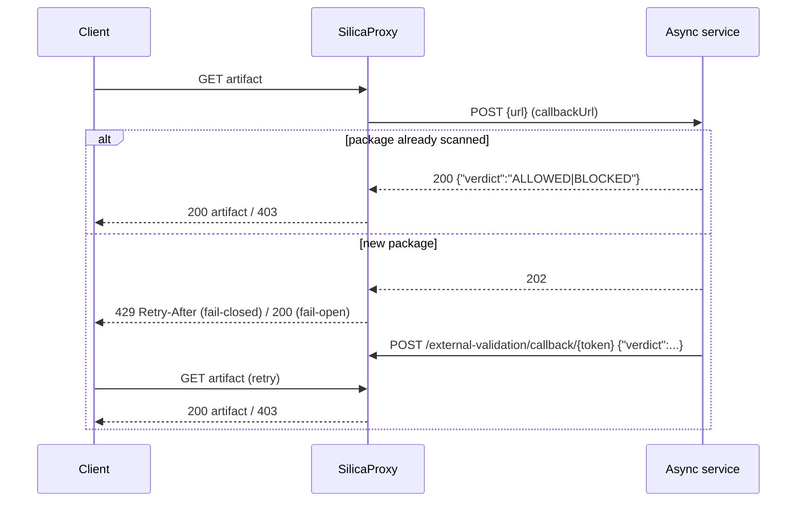

# External validation services

SilicaProxy can call any number of external HTTP services to validate a package before reaching the live API fallback. This is designed for deep scanners that are too slow to block a build synchronously, or for proprietary tools with custom scoring.

## Sync mode

The proxy makes a POST call to the service and waits up to `timeout-seconds` (1 second by default) for a response. If the service replies in time, the verdict is applied immediately. On timeout, network error or unexpected verdict, the configurable `fail-open` / `fail-closed` policy applies (see [Missing verdict](#missing-verdict-fail-closed--429)).

```
POST {url}
Body: { "packageName": "lodash", "version": "4.17.21", "ecosystem": "npm",
        "url": "https://registry.npmjs.org/lodash/-/lodash-4.17.21.tgz" }

Response: { "verdict": "BLOCKED", "reason": "Malicious dependency detected." }
```

## Async mode

The proxy POSTs a trigger and waits only for the acknowledgment (`http-client.external-validation-read-timeout-seconds`, 1 s by default). The service scans in the background and calls back the proxy with the verdict. A service that **already knows** the package may put the verdict in the acknowledgment itself: it is applied to the current request, with no 429 and no wait for the callback.

```
POST {url}
Body: { "packageName": "lodash", "version": "4.17.21", "ecosystem": "npm",
        "url": "https://registry.npmjs.org/lodash/-/lodash-4.17.21.tgz",
        "callbackUrl": "https://proxy.yourcompany.com/external-validation/callback/{token}" }

Acknowledgment (2xx), either:
  { "verdict": "ALLOWED", "reason": "Clean." }    # known package : applied now
  anything else (empty, 202, {"status":"PENDING"}) # verdict to come by callback

→ Callback (later): POST /external-validation/callback/{token}
  Header: Authorization: Bearer {api-key}   # only required if api-key is configured for this service
  Body: { "verdict": "ALLOWED", "reason": "Clean." }
```



The callback token is a UUID generated per request. The endpoint returns `404` if the token is unknown or has already been resolved — e.g. a callback still sent after a verdict given in the acknowledgment.

## Missing verdict (fail-closed → 429)

A real `BLOCKED` verdict from a `blocking: true` service is permanent: the proxy answers **403**
(step `EXTERNAL_VALIDATION`). When a `blocking: true`, `fail-open: false` service has **no verdict
yet**, the block is only temporary: the proxy answers **429** with `Retry-After`
(`silicaproxy.external-validation.retry-after-seconds`, 30 by default) and `Cache-Control: no-store`,
with one of two steps:

| Step (`error`) | Cause |
|---|---|
| `EXTERNAL_VALIDATION_PENDING` (`ExternalValidationPending`) | A scan is running: async callback not arrived yet (within `pending-ttl-minutes`), or a concurrent sync call for the same package still in progress. |
| `EXTERNAL_VALIDATION_UNAVAILABLE` (`ExternalValidationUnavailable`) | The service could not give a verdict: sync timeout, network error, unexpected verdict, an async trigger it did not acknowledge, or no callback within `pending-ttl-minutes` (the request triggers a new scan). |

A real `BLOCKED` verdict wins over a missing one, and `UNAVAILABLE` is reported before `PENDING`.
The `detail` names the services concerned. A `blocking: false` service never blocks, whatever its
`fail-open`.

Why 429 and not 403: behind Artifactory or Nexus, a 403 from the upstream may be kept in the
repository's negative cache, so the artifact would stay unavailable long after the scan allowed it.
Why not 503: a 5xx can make the repository manager take the **whole** remote repository offline.

With an async service in fail-closed, the **first** download of a version the service has not
scanned yet is therefore refused (Gradle or npm fail on it): retry once the scan has called back.

If `api-key` is configured for the service (see [Configuration Reference](configuration.md#full-variable-table)), the callback must present it back as `Authorization: Bearer {api-key}`, or the endpoint returns `401`. This is optional: a service with no `api-key` configured accepts callbacks with no `Authorization` header at all, exactly as before. The unguessable per-request UUID token is itself some protection, but it's not authentication — anyone who learns a pending token (logs, a leaked URL, a network observer) can otherwise forge a verdict for that request without it.

## Persistence

| Verdict | Destination | Expiry |
|---|---|---|
| BLOCKED (blocking=true) | `external_validation_verdicts` | **Permanent** — no TTL, manual removal only |
| ALLOWED | `external_validation_cache` | Configurable TTL (`cache-ttl-minutes`) |
| PENDING (async, waiting) | `external_validation_cache` | Configurable TTL (`pending-ttl-minutes`), then → TIMEOUT |
| BLOCKED (blocking=false) | `external_validation_verdicts` | **Permanent** — stored for observability, but never enforced as long as `blocking=false` |

A BLOCKED verdict written to `external_validation_verdicts` is **permanent**: it is never cleaned up automatically and is applied on every subsequent request for that package. Only a company policy can override it, since company policies are evaluated before the external validation services.

When every enabled service definitively ALLOWED the package and the [fallback chain](how-it-works.md#5-live-security-api-fallback--on-demand-configurable-cache-priority-3) then allows it too, that final ALLOW is cached in `api_cache` (source `EXTERNAL_VALIDATION_CHAIN`), so the next downloads skip the registry, external and OSV calls. Its TTL is the smallest of `api-cache.allow-verdict-ttl-minutes` and the remaining validity of each service's ALLOW (at most its `cache-ttl-minutes`). Nothing is cached while a scan is pending or after a fail-open error/timeout, and an async BLOCKED callback deletes the cached ALLOW so the very next request is blocked.

## Multi-service execution order

When multiple services are configured:

0. **Short-circuit**: if *any* service with `blocking: true` already has a permanent verdict for this exact package/version (from a previous sync call or async callback), the proxy returns `BLOCK` immediately and skips every network call — to its own service and to every other configured service. This is what makes the permanent block in step 4 actually permanent in practice: once one blocking scanner has spoken, the others are never asked again for that package/version.
1. Otherwise, all **SYNC** services run in parallel — the proxy waits for every sync response.
2. If any sync service produces an effective BLOCK → the package is blocked. ASYNC services are **not triggered**, unless `trigger-async-on-sync-block: true` (in which case they run fire-and-forget, for the audit trail only).
3. If all sync services ALLOW → all **ASYNC** services are triggered in parallel; the proxy waits for their acknowledgments, to use a verdict given there.
4. Final verdict: **the most restrictive wins** — one BLOCK from any service is enough.

## `blocking` flag

Each service can be configured with `blocking: false` to make it **informational only**: the verdict is still stored in the DB and appears in audit logs, but never blocks a package. Useful for trialling a new scanner in shadow mode before enforcing it.

## Upstream HEAD check (`head-check`)

Behind a virtual repository (for example a Nexus group that asks Maven Central first, then the Gradle Plugin Portal), the client's request can reach the proxy for an artifact that only one of the upstreams holds. If the scanner is called with that URL, it fetches a file that does not exist there and the package stays PENDING.

With `head-check: true`, the proxy sends a `HEAD` to the requested URL before calling the service:

- **200 / 3xx**: the artifact exists here, the service is called as usual.
- **404**: the service is skipped for this request — no call, no verdict, no PENDING row. If every service is skipped, the decision goes on with the [fallback chain](how-it-works.md#5-live-security-api-fallback--on-demand-configurable-cache-priority-3), and the request is relayed to the upstream, which answers its own 404 so the repository manager moves on to the next member.
- **Error, timeout or 429**: the service is called as if no check ran. The HEAD is an optimisation and never a reason to skip a scan on its own.

The URL is upgraded to HTTPS by the same policy as the relay (`HttpsUpgradePolicy`), and the outcome is cached in `upstream_head_cache` for `head-check-cache-ttl-minutes`. Only `found` and `not found` are cached; errors are not, so the next request retries. The HEAD goes through the same SSRF protection and upstream rate-limit suspension as the other outbound calls.

The default is `false`, so existing deployments are unchanged.

## Configuration example

```yaml
silicaproxy:
  external-validation:
    callback-base-url: "https://proxy.yourcompany.com"   # required for async mode
    trigger-async-on-sync-block: false                   # trigger async even when sync blocks
    services:
      sbom-scanner:
        enabled: true
        url: "https://scanner.yourcompany.com/v1/check"
        api-key: "${EXTERNAL_SCANNER_API_KEY}"
        mode: sync
        timeout-seconds: 1
        fail-open: true
        blocking: true
        cache-ttl-minutes: 1440
        head-check: true                 # skip this service when the upstream answers 404 for the artifact
        head-check-timeout-seconds: 5
        head-check-cache-ttl-minutes: 10

      deep-scanner:
        enabled: true
        url: "https://deep-scanner.yourcompany.com/analyze"
        api-key: "${DEEP_SCANNER_API_KEY}"
        mode: async
        fail-open: true
        blocking: true
        cache-ttl-minutes: 10080
        pending-ttl-minutes: 60

      package-name-guardian:
        enabled: true
        url: "https://package-name-guardian.yourcompany.com/api/v1/check"
        api-key: "${PACKAGE_NAME_GUARDIAN_API_KEY}"
        mode: sync
        timeout-seconds: 1
        fail-open: true
        blocking: true
        cache-ttl-minutes: 10080

      package-behavior-guardian:
        enabled: true
        url: "http://package-behavior-guardian.yourcompany.com/v1/check"
        api-key: "${PACKAGE_BEHAVIOR_GUARDIAN_API_KEY}"
        mode: async
        fail-open: false
        blocking: true
        head-check: true                 # skip the scan when the upstream answers 404 for the artifact
        cache-ttl-minutes: 10080
```

**Package-Name-Guardian example:** This configuration integrates [Package-Name-Guardian](https://github.com/Silica-Proxy/Package-Name-Guardian), a package name analysis service that validates whether package names match internal naming conventions, detects typosquatting patterns, and flags suspicious naming anomalies across ecosystems. Run it in sync mode (blocking until resolved) with a 1-second timeout.

**Package-Behavior-Guardian example:** This configuration integrates [Package-Behavior-Guardian](https://github.com/Silica-Proxy/Package-Behavior-Guardian), a behavioral analysis service that scans the whole published version of a package (npm, PyPI, Maven) to catch a compromised release minutes after it is first requested, before any advisory lists it. It runs in async mode: the first request for a new version is answered with a temporary `429` (see [Missing verdict](#missing-verdict-fail-closed--429)) and the verdict is applied when the service calls back. `fail-open: false` keeps a version without verdict out of reach, and `head-check: true` skips the scan for artifacts the upstream does not have. Because the service is async, `callback-base-url` must be set. Its authors recommend starting with `blocking: false` (observation) until false positives have been measured, as the Compose file of [Advanced setup](advanced-setup.md) does.

## Available external services

Both run next to SilicaProxy with Docker Compose, see [Advanced setup](advanced-setup.md).

| Service | Purpose | Repository |
|---|---|---|
| **Package-Name-Guardian** | Validates package names against internal conventions; detects typosquatting and naming anomalies | [Silica-Proxy/Package-Name-Guardian](https://github.com/Silica-Proxy/Package-Name-Guardian) |
| **Package-Behavior-Guardian** | Behavioral analysis of npm, PyPI and Maven packages (static pass) to catch compromised releases before public advisories; async | [Silica-Proxy/Package-Behavior-Guardian](https://github.com/Silica-Proxy/Package-Behavior-Guardian) |
